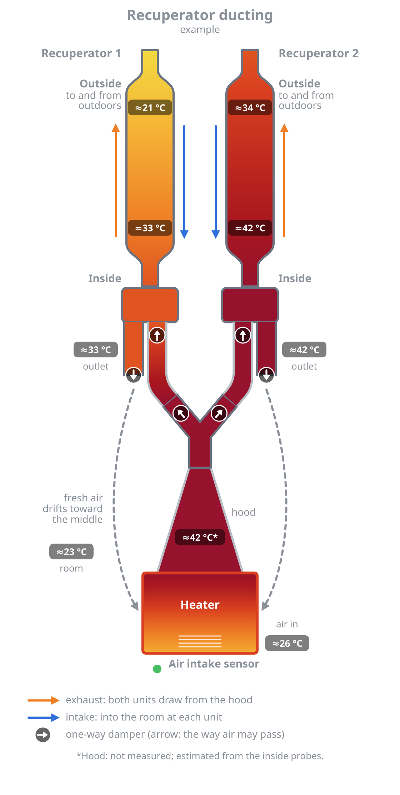

# Basement ducting card

A Home Assistant dashboard card that draws two recuperators exhausting through a shared hood over a heater, with
each unit supplying fresh air into the room through its own outlet. Every part that carries air is coloured by
temperature from your sensors, and the picture moves with the airflow: streaks run up a unit's pipe, hose and the
hood while it exhausts, and down its pipe and out of its outlet while it takes air in.



It uses the temperature scale of the [Recuperator integration](https://github.com/geirskogul/recuperator)'s
diagram (after the U.S. National Weather Service temperature maps) and reads that integration's **Phase** sensors,
but any sensors work: a phase sensor only needs the states `exhaust` and `intake`.

## Installing

**HACS:** HACS → ⋮ → Custom repositories → add `https://github.com/geirskogul/basement-ducting-card`, type
**Dashboard**. Then find **Basement ducting card** in HACS, download it and reload the browser. HACS adds the
dashboard resource.

**By hand:** copy `basement-ducting-card.js` to `/config/www/`, then Settings → Dashboards → ⋮ → Resources → add
`/local/basement-ducting-card.js` as a JavaScript module.

Then add a card to a dashboard: pick **Basement ducting card** in the card list (it has a visual editor; `notes` and
`markers` are set in YAML), or use a Manual card:

```yaml
type: custom:basement-ducting-card
title: Basement ducting
left:
  name: Recuperator 1
  inside: sensor.recuperator_1_inside
  outside: sensor.recuperator_1_outside
  phase: sensor.recuperator_1_phase
right:
  name: Recuperator 2
  inside: sensor.recuperator_2_inside
  outside: sensor.recuperator_2_outside
  phase: sensor.recuperator_2_phase
heater_intake: sensor.heater_intake
room: sensor.room_temperature
```

## The picture

```
   outside ends (to and from outdoors)
   ┌───────┐                ┌───────┐
   │ left  │                │ right │     the cores, with their outside and inside probes
   │ unit  │                │ unit  │
   └───┬───┘                └───┬───┘
   [  wye  ]                [  wye  ]     each unit's wye: one branch to the hood, one into the room
  outlet│  hose          hose  │outlet
        ↓    \            /    ↓          supply air into the room at each unit
              ╲ hood wye ╱
                  hood                    both units exhaust from here
               [ heater ]                 room air in at the bottom, warmed toward the hood
```

Each exhaust path has two one-way dampers (in the hood wye's arm and where the hose enters the unit's wye) and
each outlet one (at its end), as drawn.

## Options

| Option | Default | What |
| --- | --- | --- |
| `title`, `subtitle` | `Recuperator ducting`, `live` | Text at the top of the picture. |
| `animate` | `true` | Moving streaks and fading colour changes. `false` keeps the colours and arrows still. Browsers that ask for reduced motion get no movement either way. |
| `unit` | `auto` | `°C` (or `C`) or `°F` (or `F`) for the readings; `auto` follows Home Assistant's unit system. Sensors in °F or K are converted for the colours. |
| `left`, `right` | | One block per unit, below. |
| `hood` | | Optional sensor in the hood. Without it the hood shows the hood wye's sensor, or else an estimate (marked `*`) from the breathing cycles; see [The hood without a sensor](#the-hood-without-a-sensor). |
| `hood_wye` | | Optional sensor in the middle of the hood's wye. The hood then runs from `hood` at the bottom to this at the top, and the hoses start from it. |
| `heater_intake` | | Optional sensor at the heater's air intake: the bottom of the heater's gradient (the top is the hood). Without it the room temperature is used. |
| `room` | | Optional room sensor, or a list of them (averaged). Colours an idle outlet without its own sensor and the bottom of the heater when there is no `heater_intake`, and gets its own badge. |
| `heater` | | Labels: `name` (default `Heater`; `\n` for a new line), `note` (under the name), `intake_name` (default `Heater air intake`) and `intake_detail`: the label of the `heater_intake` sensor, shown when that is set. |
| `hose_note` | | A line of text at the bottom. |
| `notes` | | A line or a list of lines that replaces the notes at the bottom: `hose_note` and the automatic ones (including the explanation of `*`). Three lines fit. |
| `markers` | | Green dots for things without a reading, e.g. a CO2 sensor: `- {name: CO₂ sensor, detail: near the outlet, side: left}`. One per side, next to that unit's outlet; without `side: right` a marker goes on the left. |

Each unit (`left`, `right`):

| Option | What |
| --- | --- |
| `name` | Label above the unit (default `Recuperator 1` / `Recuperator 2`; `\n` for a new line). |
| `inside` | Probe at the room end of the core. |
| `outside` | Probe at the outdoor end of the core. |
| `phase` | Entity with the state `exhaust` or `intake` (e.g. the Recuperator integration's Phase sensor; a `select` or `input_select` works too). Any other state counts as idle. |
| `wye` | Optional sensor in the middle of the unit's wye. The wye then runs from `inside` (top) to it (bottom), and the hose ends at it. |
| `outlet` | Optional sensor in the room outlet. While the unit takes air in, the outlet runs from the wye (top) to it (bottom); otherwise it shows this sensor. Its reading is in the outlet's badge (labelled "outlet"); without it the badge ("supply") shows the wye's reading while the unit takes air in and "idle" otherwise. |

## Replay

Below the picture, **Replay** plays back the recorder's history of the card's sensors in the same picture, like the
Recuperator integration's replay but inside the card. Pick the period (it starts as the last `replay_hours`), press
**Load**, and it plays at the chosen speed (`replay_speed`, e.g. 120× shows two hours in one minute). Pause, change
the speed or drag the timeline at any time; the time shown is at the top of the picture and next to the timeline.
**Back to live** returns to the live readings (live changes are held back while replaying).

The history comes straight from Home Assistant (`history/history_during_period`), so it reaches back only as far as
the recorder keeps it (10 days by default). Long periods of sensors that report every few seconds take a moment to
load. For an idle hose or outlet, the replay uses each unit's last exhaust and intake before the moment shown, read
from the history, so jumping around the timeline shows the same as playing through it.

| Option | Default | What |
| --- | --- | --- |
| `replay` | `true` | Show the Replay button. |
| `replay_hours` | `1.5` | How far back the period starts when Replay is opened. |
| `replay_speed` | `120` | Starting playback speed (30, 60, 120, 300, 600 or 1800 in the menu; any other number is added to it). |

## How each part is coloured

| Part | Colour |
| --- | --- |
| Pipe (the core) | `outside` at the top to `inside` at the bottom. |
| Unit's wye | `inside` to `wye` (or `inside` alone). |
| Hose | Hood wye (or hood) at the hood end. The unit end: while the unit exhausts, its `wye` (or `inside`); otherwise the dampers are shut and the hose keeps that unit's last exhaust reading (the hood's until there is one). |
| Outlet | While the unit takes air in: the wye's temperature (`wye`, or `inside`) to `outlet` (or the wye's alone). Otherwise `outlet`, or the room, or the last supply reading. |
| Hood | `hood` to `hood_wye`; with neither, the estimate below. |
| Hood wye | `hood_wye`, else as the hood. |
| Heater | `heater_intake` (or the room) at the bottom to the hood at the top. |

A part with a reading at one end only takes that colour; a part with none turns grey.

### The hood without a sensor

With neither `hood` nor `hood_wye`, the hood's temperature comes from the breathing cycles. A cycle runs from one
start of the left unit's exhaust to the next (the right unit's, if the left has no `phase`); its **peak** is the
highest inside-probe reading of a unit while that unit exhausts, the warmest hood air the probes saw.

- **Replay:** during each cycle the hood fades from the previous cycle's peak (at its start) to this cycle's peak (at
  its end). The replay loads an hour more history on each side of the chosen period so that the first and last
  cycles have their peaks. A cycle that runs into the present has no known peak yet, so the hood stays at the
  previous one.
- **Live:** the peak of the cycle under way is not known until it ends, so the hood stays at the last complete
  cycle's peak and moves to the new one (with the usual fade) as each cycle ends. When the card loads it reads the
  last two hours of history to know that peak at once.

Without phase sensors or history, the hood falls back to the inside probe of a unit that is exhausting (the warmer,
if both are), or else of the last unit that did.

## A static picture

`tools/render.mjs` writes the same picture as an SVG from fixed readings, for a README or a wiki:

```sh
node tools/render.mjs docs/example/config.json docs/example/readings.json example.svg [°C|°F]
```

`config.json` holds the card's options (JSON); `readings.json` the temperatures in °C
(`left`/`right`: `inside`, `outside`, `wye`, `outlet`, and `supply` for the outlet; and `hood`, `hood_wye`,
`heater_intake`, `room`). A reading gets its number only when its option is set in `config.json` (any entity id
will do there); without it, it still colours the picture. Arrows are drawn as if both units were running; nothing
moves.

`tools/check.mjs` checks the colouring rules (`node tools/check.mjs`).

`tools/test.html` shows three cards with mock readings in a browser, and `tools/replay-test.html` runs a replay
against a mock Home Assistant (see the comments at their tops).

## Licence

MIT
